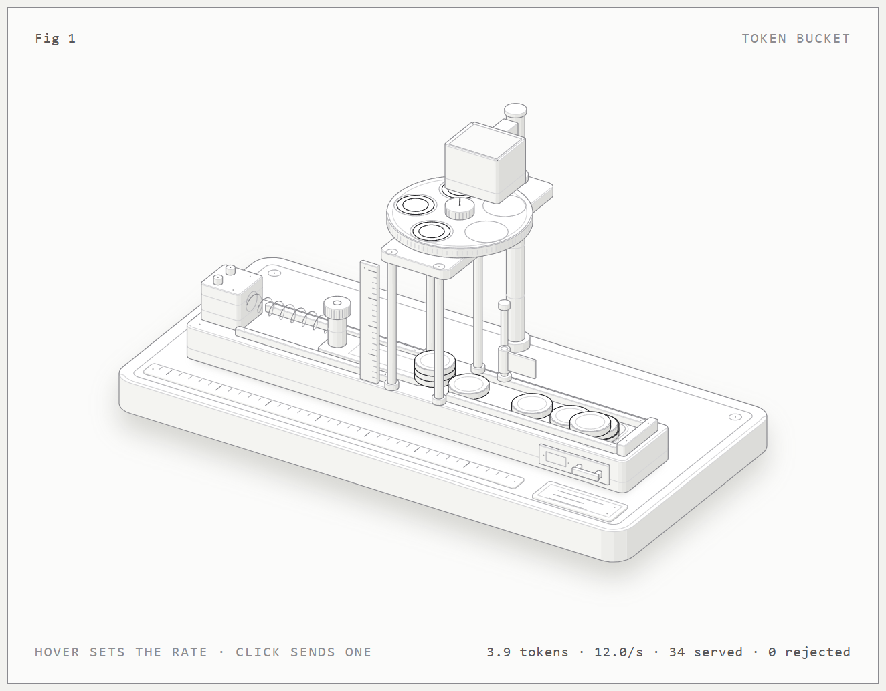
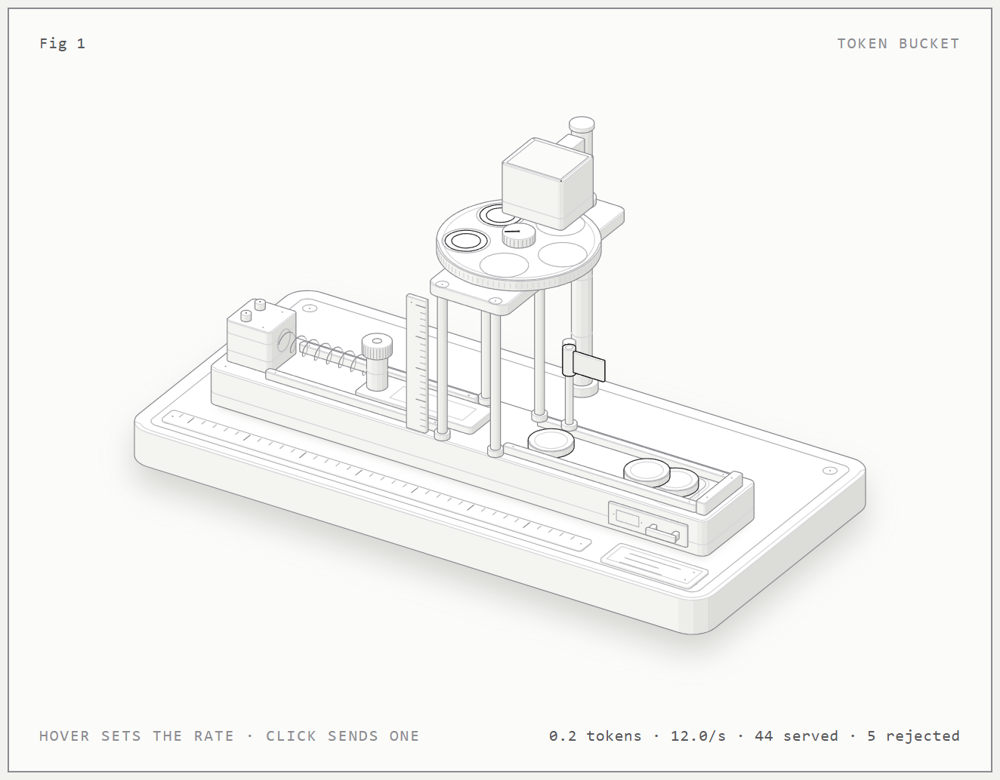
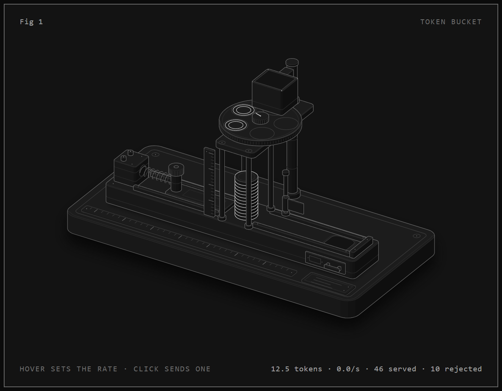
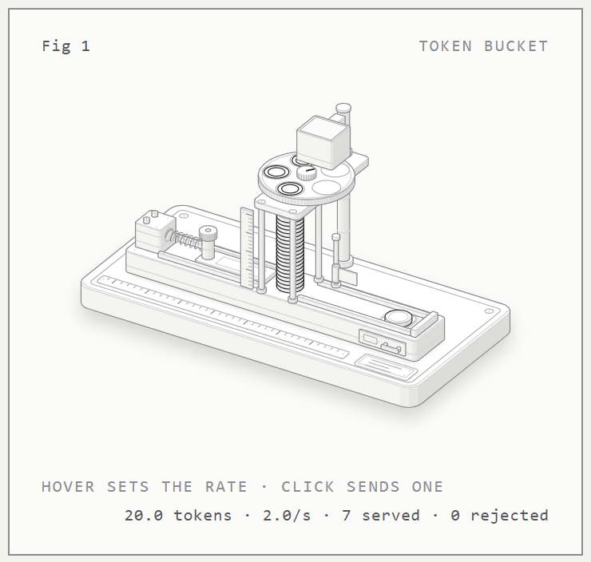

# anatomy-test

A first test of the **Anatomy** skill for Claude Code, plus a set of docs about the skill.

- Original skill: [github.com/wheresryan22/anatomy](https://github.com/wheresryan22/anatomy) (version 1.1.0 plus `[Unreleased]` changes, MIT license)
- Video that introduced it: [Better Stack on YouTube](https://www.youtube.com/watch?v=lyGYidIZK4I)

Anatomy makes interactive isometric figures: it explains a concept with a small, detailed machine whose motion and readout come from one true model.

## Live pages

- [Token bucket figure, light theme](https://az9713.github.io/anatomy-test/token-bucket/token-bucket-light.html)
- [Token bucket figure, dark theme](https://az9713.github.io/anatomy-test/token-bucket/token-bucket.html)
- [Docs hub](https://az9713.github.io/anatomy-test/docs/)

## The test: a token bucket rate limiter

Prompt, run on 2026-10-21 with Claude Opus 5.5:

> `/anatomy explain how a token bucket rate limiter works: bucket holds 20 tokens, refills 5 per second, each request takes one, requests are rejected when it is empty. Figure size, interactive, one standalone HTML file, light theme, no WebGL.`

The skill made a token dispenser:

- **Bucket:** a column (a cage of 4 posts) that holds up to 20 tokens, with a 20-tick ruler beside it.
- **Refill:** a feeder disc turns once a second and drops a token from each of its 5 pockets, so 5 tokens arrive each second. It stops when the column holds 20.
- **Request:** a solenoid drives a pusher, which takes the bottom token out to a drawer.
- **Reject:** when the column is empty, the pusher finds nothing and a flag goes up.

The page and the build run the same model: `tokens = min(20, tokens + 5·dt)`; a request takes 1 token if there is at least 1, otherwise it is rejected. The build checks the model with asserts.

Controls: hover from left to right to set 0–15 requests per second; click or press space to send one request; arrow keys change the rate. With no input, an idle tour runs 2, 12, 0 and 7 requests per second in a loop.

| Full column | Empty column, request rejected |
|---|---|
|  |  |

| Dark theme | Phone, 390 px |
|---|---|
|  |  |

### Results

- First working page: about 9 minutes after the skill started. All checks and fixes: about 18 minutes.
- Line-end check (`scripts/lines.mjs`): 0 of 285 line ends float, in both themes.
- About 75 solids. There are no pipes or turned parts, so the skill's `--audit` does not apply.
- Known faults not fixed: the return spring has no rod inside it; at full stroke the pusher tip takes the same space as the bottom token; the hopper bin is a plain box; spent tokens touch each other in the channel above about 10 requests per second.
- 4× close-ups covered 5 regions, not every joint.

### Rebuild

`token-bucket/build.mjs` imports the kit from `~/.claude/skills/anatomy`, so install the skill there first. Then:

```
node token-bucket/build.mjs          # light: token-bucket-light.html
node token-bucket/build.mjs --dark   # dark: token-bucket.html
```

## Docs

`docs/` is a documentation set for the Anatomy skill (overview, getting started, guides, concepts, reference, architecture, troubleshooting), written 2026-10-21. Start at the [docs hub](https://az9713.github.io/anatomy-test/docs/) or [docs/index.md](docs/index.md).

The docs name files in the skill's own repo as `anatomy-main/…`, and quote the video's transcript. Neither is in this repo: get the skill from the original repo and watch the video.

## License

The two token-bucket HTML pages contain the Anatomy kit source, which is under the MIT license, Copyright (c) 2026 Ryan. See [LICENSE-anatomy](LICENSE-anatomy).
